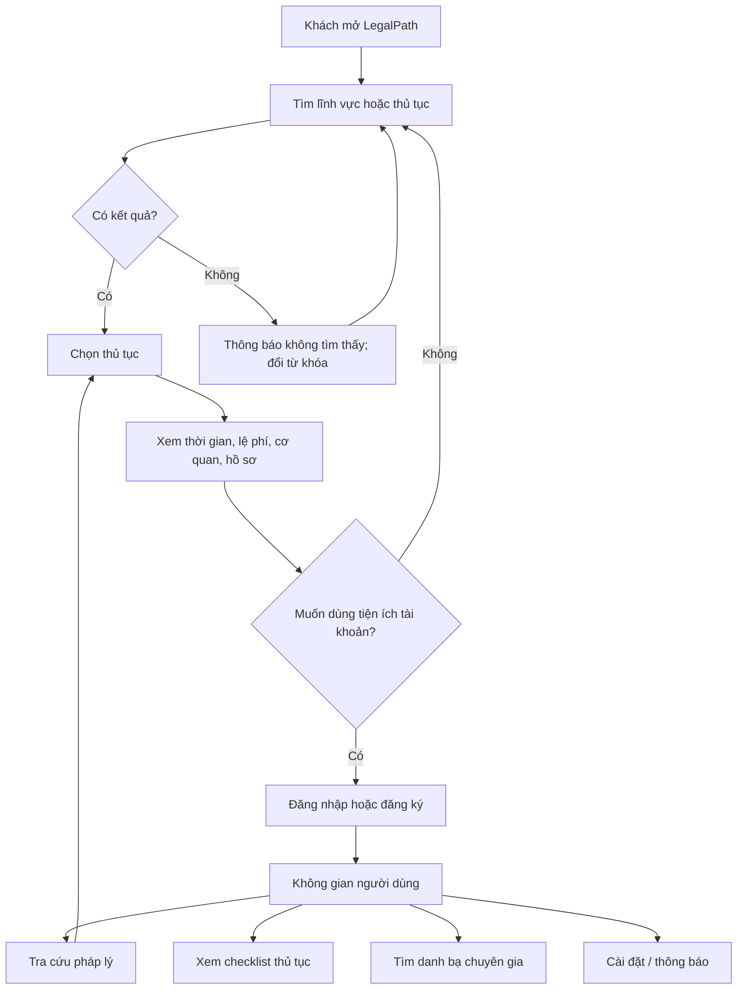
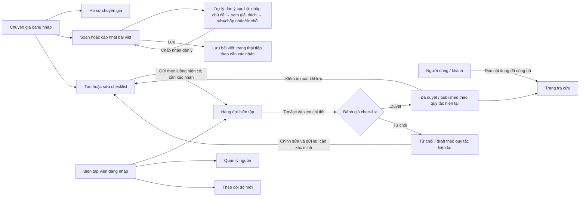
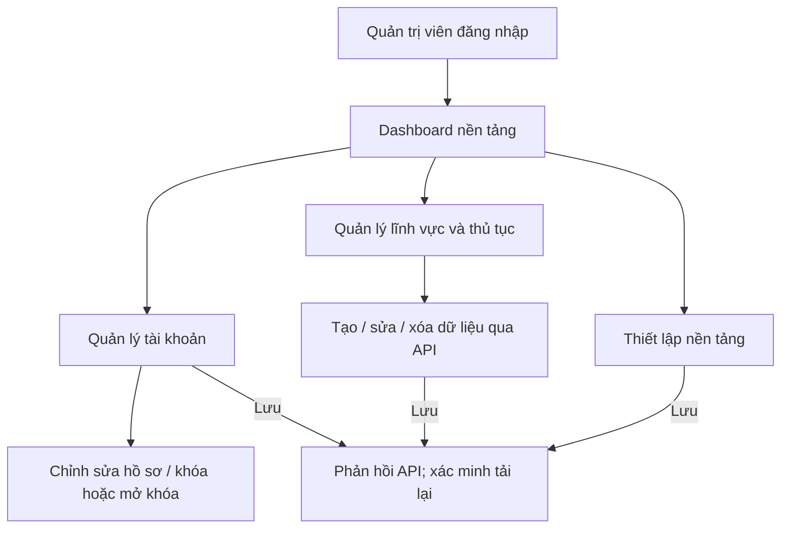
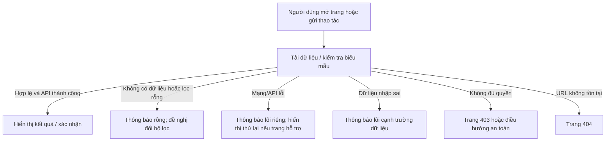

# Sơ đồ User Flow

Sơ đồ dưới đây biểu diễn luồng sản phẩm dự kiến dựa trên điều hướng và chức năng nhìn thấy trong repository. Mũi tên không thay thế kiểm thử trực tiếp; nhánh ghi “cần xác nhận” phải được nhóm đối chiếu với hành vi thật.

## Luồng công khai và người dùng

## Luồng chuyên gia và biên tập viên

## Luồng quản trị

## Luồng ngoại lệ dùng chung

## Handoff kiểm thử

1. Chạy từng luồng bằng dữ liệu demo, ghi lại kết quả và lỗi thực tế.
2. Với hàng đợi, thử checklist chờ duyệt → duyệt, chờ duyệt → từ chối, sau đó tải lại trang.
3. Với mọi API, thử thành công, danh sách rỗng, lỗi mạng và dữ liệu sai định dạng; ghi rõ trang nào có nút thử lại.
4. Xác nhận liên kết từ trang công khai sang đăng nhập và từ từng role tới trang dùng chung.
5. Đính kèm screenshot/video OBS và URL Figma frame tương ứng trong [screen inventory](./screen-inventory.md).

Các trạng thái chưa được xác nhận trong mã được đánh dấu trong [bảng kiểm kê](./screen-inventory.md).
